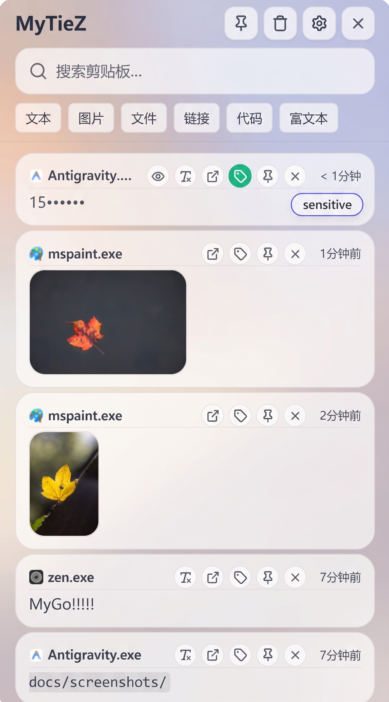
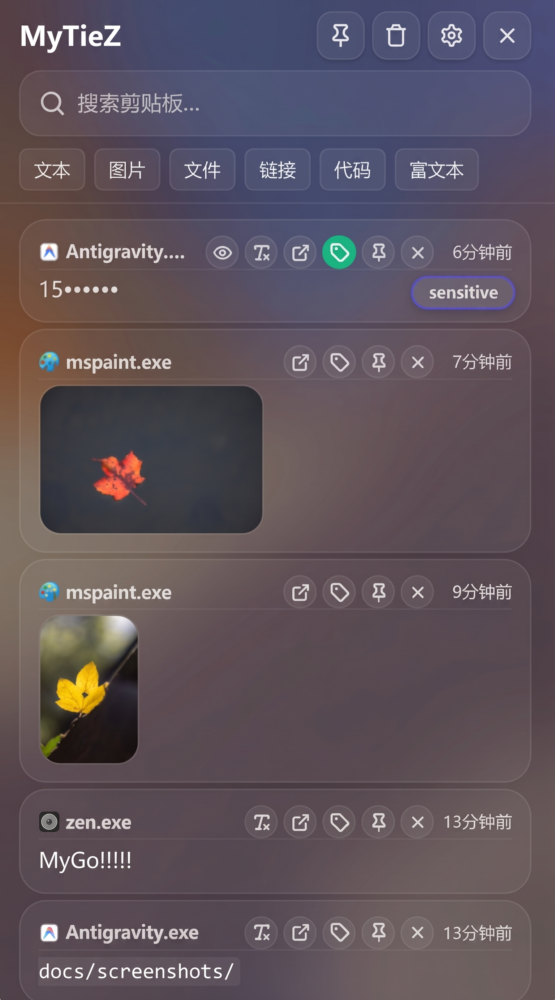
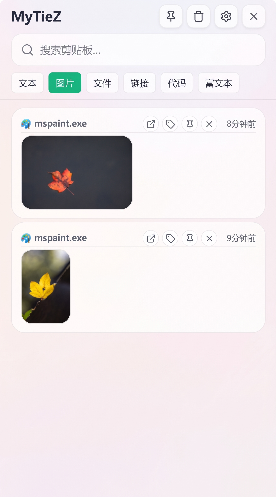
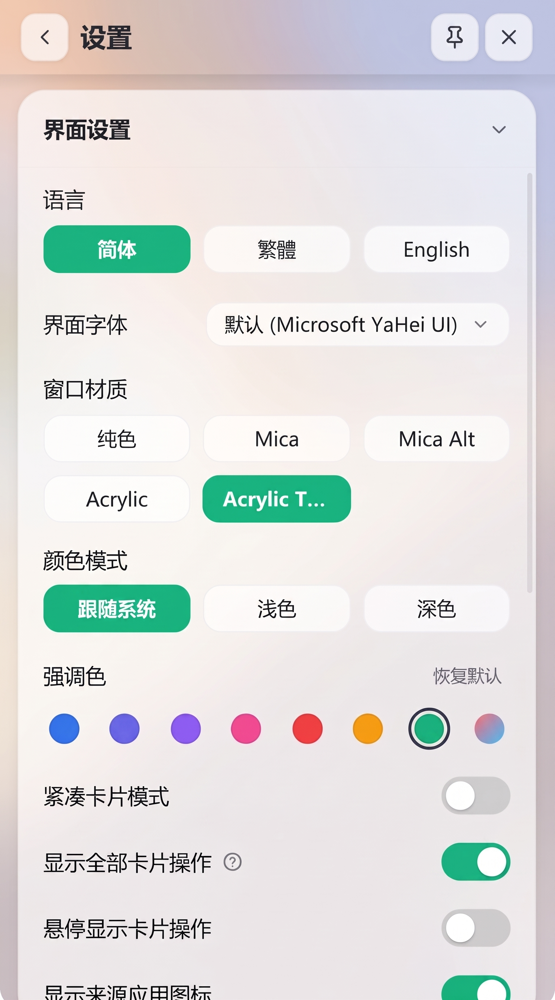

# MyTieZ

基于 Go 与原生 UI 框架 [MyGo](https://github.com/egoist/mygo) 编写的轻量级桌面剪贴板管理工具，界面设计与核心交互参考自 [tiez-clipboard](https://github.com/jimuzhe/tiez-clipboard)。

## 下载安装

- **Windows 安装包（amd64，v0.1.6）**：[mytiez-setup-0.1.6-amd64.exe](https://github.com/llxo/MyTieZ/releases/download/v0.1.6/mytiez-setup-0.1.6-amd64.exe)
- **全部版本**：[GitHub Releases](https://github.com/llxo/MyTieZ/releases/latest)

## 界面预览

<table>
  <tr>
    <th width="25%">主面板（浅色）</th>
    <th width="25%">主面板（深色）</th>
    <th width="25%">分类筛选</th>
    <th width="25%">界面设置</th>
  </tr>
  <tr>
    <td align="center"></td>
    <td align="center"></td>
    <td align="center"></td>
    <td align="center"></td>
  </tr>
</table>

## 核心特性

- **轻量原生体验**：采用纯 Go 与原生 UI 渲染构建，安装包小巧，启动与响应迅速，长时间后台运行也能保持较低的内存占用。
- **系统级视觉融合**：支持 Mica / Acrylic 背景材质、浅色/深色与跟随系统主题，以及自定义强调色和界面字体。
- **全格式记录与高效检索**：自动收集纯文本、富文本、链接、代码、图片与文件列表，支持关键字、中文拼音及 `#标签` 筛选，历史记录再多也能快速定位。
- **流畅的粘贴工作流**：支持接管 `Win+V` 或自定义全局热键呼出，提供鼠标跟随、边缘自动停靠、不抢焦点模式与快捷键快速粘贴，减少窗口切换打断。
- **本地存储与隐私保护**：所有记录保存在本地 SQLite，支持对手机号、邮箱、密钥等敏感内容自动识别与脱敏预览，并在 Windows 下加密存储。
- **多语言与自动更新**：内置简体中文、繁體中文、English 三语切换，支持应用内检查与更新。

## 平台支持说明

- **Windows（主力支持）**：完整支持剪贴板监听、自动粘贴、`Win+V` 接管、来源应用识别、系统托盘与自动更新。
- **macOS（基础可用）**：UI、剪贴板监听与读写、搜索、标签与托盘均可正常构建运行；自动粘贴、来源应用捕获与前台窗口追踪目前为跨平台占位实现，点击条目仅写入剪贴板。

## 开发与测试

环境要求：Go `1.27+`，并安装 [MyGo CLI](https://github.com/egoist/mygo)：

```powershell
# 安装 mygo CLI
go install github.com/egoist/mygo/cmd/mygo@latest

# 开发预览
mygo dev

# 修改 locales/*.json 后重新生成多语言目录
mygo generate

# 运行单元测试
go test -count=1 ./internal/...

# 静态检查
go tool mygo vet .

# 打包发布
mygo build
```

## 目录结构

```text
├── main.go              # 应用入口与内嵌资源
├── mygo.json            # MyGo 应用与 i18n 配置
├── locales/             # 简体中文 / 繁體中文 / English 语言文件与生成代码
└── internal/
    ├── app/             # 主面板、设置页、交互与缓存
    ├── store/           # 本地存储、分类检索、隐私保护与加密
    └── sys/             # 平台原生能力桥接
```

## 致谢

- 界面设计与核心交互参考自 [jimuzhe/tiez-clipboard](https://github.com/jimuzhe/tiez-clipboard)，在此基础上使用 MyGo 原生 UI 重新实现。
- 感谢 [egoist/mygo](https://github.com/egoist/mygo) 提供的 Go 原生桌面 UI 与系统集成框架。

## License

[GPL-3.0](./LICENSE)
