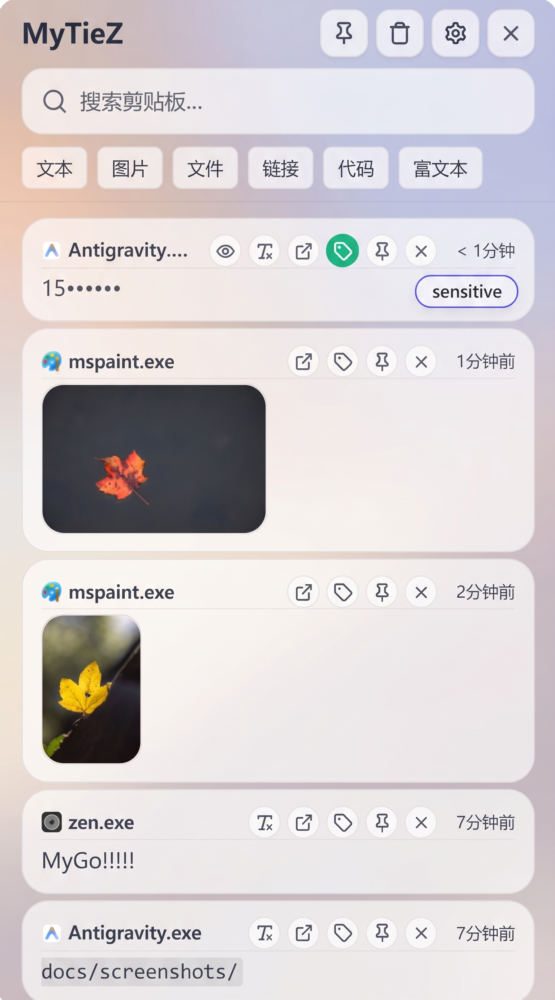
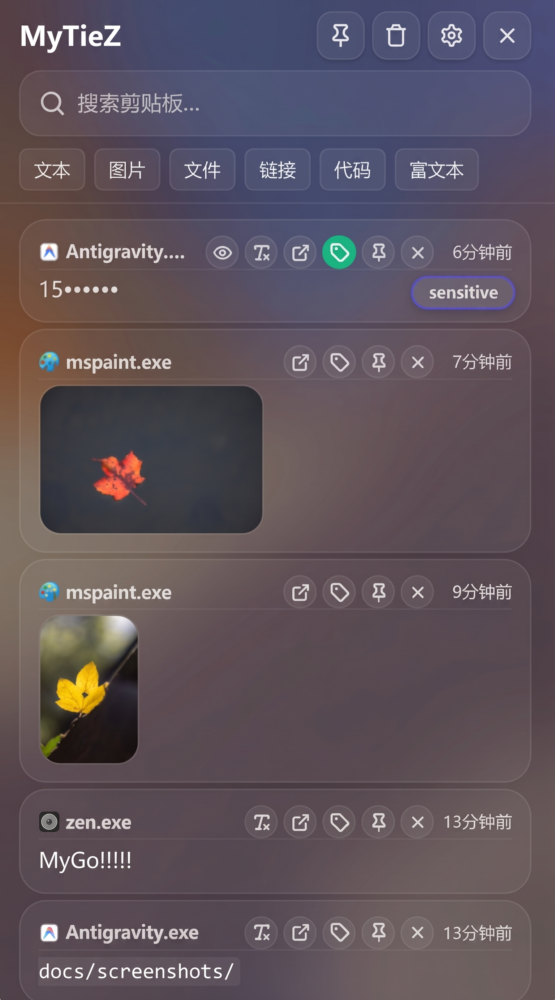
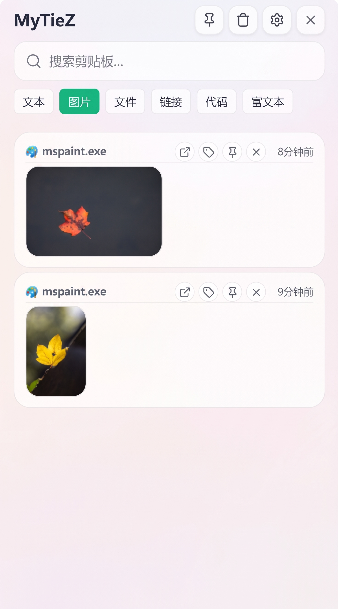
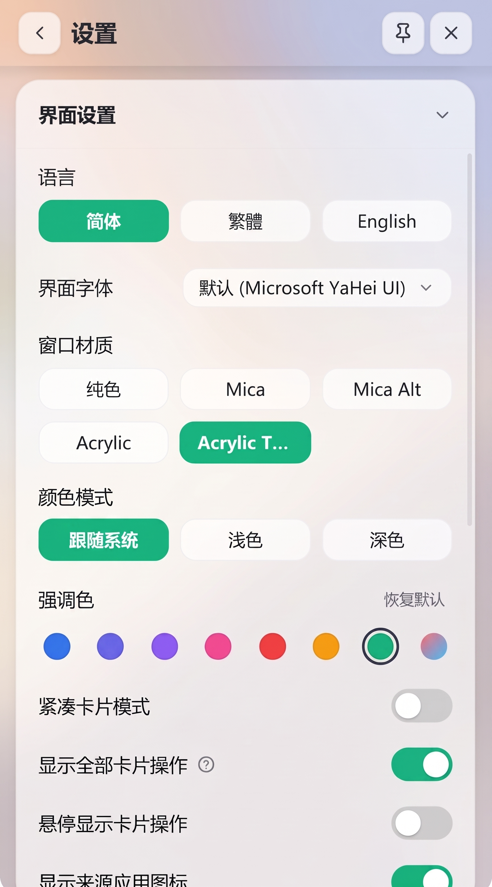

# MyTieZ

[简体中文](./README.md) | English

A lightweight desktop clipboard manager built with Go and the native UI framework [MyGo](https://github.com/egoist/mygo), with UI design and core interactions inspired by [tiez-clipboard](https://github.com/jimuzhe/tiez-clipboard).

## Download

- **Windows Installer (amd64, v0.1.6)**: [mytiez-setup-0.1.6-amd64.exe](https://github.com/llxo/MyTieZ/releases/download/v0.1.6/mytiez-setup-0.1.6-amd64.exe)
- **All Releases**: [GitHub Releases](https://github.com/llxo/MyTieZ/releases/latest)

## Screenshots

<table>
  <tr>
    <th width="25%">Main Panel (Light)</th>
    <th width="25%">Main Panel (Dark)</th>
    <th width="25%">Category Filter</th>
    <th width="25%">Appearance Settings</th>
  </tr>
  <tr>
    <td align="center"></td>
    <td align="center"></td>
    <td align="center"></td>
    <td align="center"></td>
  </tr>
</table>

## Features

- **Lightweight & Native**: Built with pure Go and native UI rendering for a compact installer, fast startup, and low idle memory usage in the background.
- **Native Visual Integration**: Supports Mica / Acrylic window backdrops, Light / Dark / System color modes, custom accent colors, and interface font selection.
- **Rich Formats & Fast Search**: Automatically captures plain text, rich text, links, code snippets, images, and file lists, with instant search by keywords, Chinese Pinyin, and `#tags`.
- **Smooth Paste Workflow**: Supports `Win+V` override or custom global hotkeys, cursor-following popup, edge docking, no-focus mode, and shortcut-key pasting without interrupting your current window.
- **Local Storage & Privacy**: Stores history locally in SQLite, automatically detects and masks sensitive items (phone numbers, emails, secrets, etc.), and encrypts sensitive data via DPAPI on Windows.
- **Multilingual & Auto-Update**: Built-in Simplified Chinese, Traditional Chinese, and English support with in-app update checks.

## Platform Support

- **Windows (Primary)**: Full support for clipboard watching, auto-paste, `Win+V` override, source app detection, system tray, and auto-update.
- **macOS (Basic)**: UI, clipboard watching/writing, search, tags, and tray build and run directly; native system bridges for auto-paste, source app capture, and foreground tracking are currently stubs (clicking an item copies it to the clipboard).

## Development & Testing

Requires Go `1.27+` and the [MyGo CLI](https://github.com/egoist/mygo):

```powershell
# Install mygo CLI
go install github.com/egoist/mygo/cmd/mygo@latest

# Run in development mode
mygo dev

# Regenerate i18n catalog after editing locales/*.json
mygo generate

# Run unit tests
go test -count=1 ./internal/...

# Run static checks
go tool mygo vet .

# Build release package
mygo build
```

## Project Structure

```text
├── main.go              # Application entry point and embedded assets
├── mygo.json            # MyGo app and i18n configuration
├── locales/             # Simplified Chinese / Traditional Chinese / English locales
└── internal/
    ├── app/             # Main panel, settings view, interactions, and caches
    ├── store/           # Local SQLite storage, search, privacy masking, and encryption
    └── sys/             # Platform-native system bridges
```

## Acknowledgements

- UI design and core interactions are inspired by [jimuzhe/tiez-clipboard](https://github.com/jimuzhe/tiez-clipboard), reimplemented with MyGo native UI.
- Thanks to [egoist/mygo](https://github.com/egoist/mygo) for the Go native desktop UI and system integration framework.

## License

[GPL-3.0](./LICENSE)
